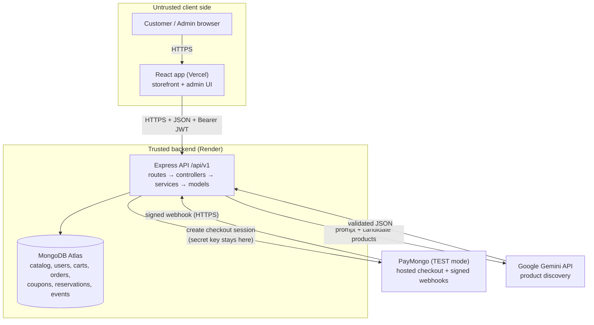
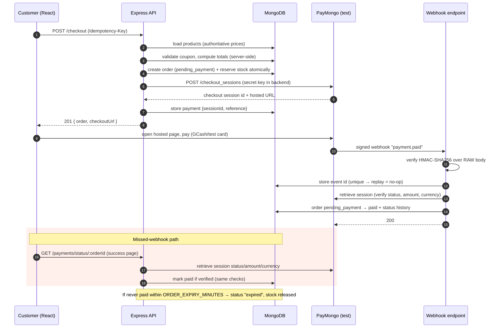
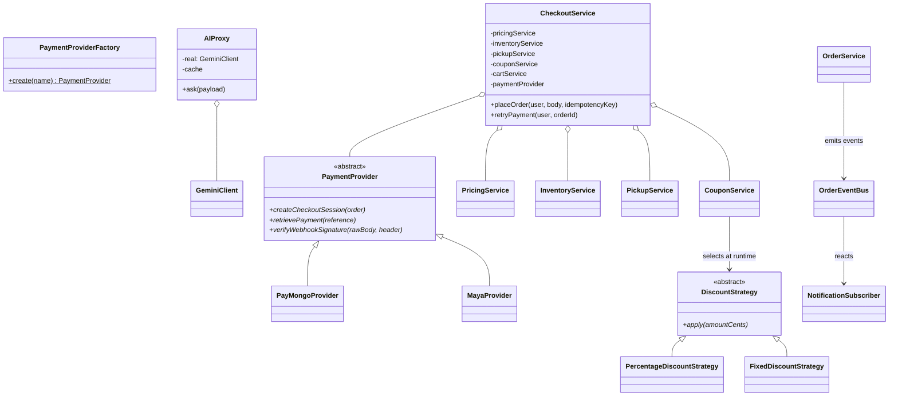

# SPC Book Store — System Architecture

Campus bookstore concept (St. Peter's College, Iligan City): verified-student
discounts, campus pickup slots, course-coded book lists, and pre-orders.

## 1. Context diagram (T-21)



**Trusted vs untrusted.** The browser and the React app are untrusted: they can
send anything. Business rules (pricing, coupons, stock, roles, payment
verification) live only in the Express API, which is the only component that
talks to the database, the gateway secret key and the Gemini API key.

## 2. Layered architecture (T-01)

```
Request
  → routes/index.js          Express router + validation + role middleware
  → controllers/*.js         thin: call service, format envelope
  → services/*.js            business rules (pricing, checkout, orders, AI...)
  → models/*.js              Mongoose schemas / persistence
  → patterns/*.js            factories, providers, strategies, observers, proxy
Response
```

A live trace of `GET /api/v1/products`:
`routes/index.js` → `wrap(productController.list)` →
`productService.listPublic()` → `Product.find(...)` → response envelope.

## 3. Checkout sequence, including the missed-webhook path (T-22)



## 4. Class / module model (T-23)



## 5. Deployment topology

- **Frontend:** Vercel (React + Vite) — set `VITE_API_URL` to the API URL.
- **API:** Render (Node web service) — root `backend/`, start `npm start`.
- **Database:** MongoDB Atlas — network access limited to the API host.
- **Webhook:** register `https://<api-domain>/api/v1/payments/webhook` in the
  PayMongo dashboard; for local development use ngrok and re-register.
- Free tiers sleep: wake the API before the defense and keep a backup recording.
