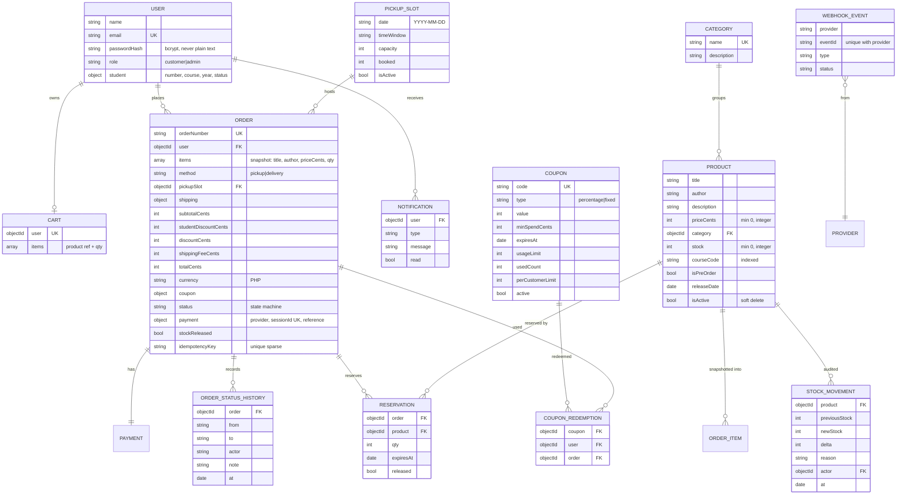

# SPC Book Store — Database Design

MongoDB + Mongoose. All money is stored as **integer centavos** (never floating
point): `PHP 450.00 = 45000`.

## ERD (D-03)



## Collections, constraints and indexes

| Collection | Key constraints / indexes |
|---|---|
| `users` | `email` **unique**; `role` index; `passwordHash` bcrypt only |
| `categories` | `name` unique |
| `products` | `category`, `isActive`, `courseCode` indexes; money fields integer ≥ 0 |
| `carts` | `user` unique (one cart per customer) |
| `coupons` | `code` unique |
| `couponredemptions` | unique `(coupon, order)`; `(coupon, user)` for per-customer limit |
| `orders` | `orderNumber` unique; `idempotencyKey` **unique sparse**; `payment.sessionId` **unique sparse**; `(user, createdAt)` index; status enum |
| `orderstatushistories` | `(order, at)` index — full audit of transitions |
| `stockmovements` | `(product, at)` index — previous/new value, delta, reason, actor |
| `reservations` | `order` index, `released` flag, `expiresAt` |
| `pickupslots` | unique `(date, timeWindow)` |
| `webhookevents` | unique `(provider, eventId)` — idempotent webhook storage |
| `notifications` | `(user, createdAt)` index |

## Integrity decisions

- **Money:** integers (centavos) only; Mongoose validators enforce `Number.isInteger`, `min: 0`.
- **Order items are snapshots** (`title`, `author`, `priceCents` copied): product edits never corrupt order history; deleting a product in an order is a *soft delete* (`isActive=false`), so no orphan items.
- **Stock integrity:** reservation uses a conditional `findOneAndUpdate({_id, stock: {$gte: qty}}, {$inc: {stock: -qty}})` — atomic, no overselling; failed checkouts roll back; `stockReleased` on the order guarantees release runs exactly once.
- **Webhook idempotency:** unique `(provider, eventId)` makes replays no-ops at the database level.
- **Status integrity:** status changes only through `OrderService.transition`, which validates the state machine and writes history.

## Seed and reset (T-09, L1-13)

```bash
cd backend
npm run seed         # upsert: 5 categories, 26 products, 3 coupons, 10 pickup slots,
                     # admin + 2 customers (re-running creates no duplicates)
npm run seed:reset   # wipe this database, then seed
```

The commands only touch the database named in `MONGO_DB_NAME`. Seed data
includes one deliberately expired coupon (`EXPIRED5`) and one pre-order product
for negative tests.
